<a href="https://devbyleny.vercel.app"><picture><source media="(prefers-color-scheme: dark)" srcset="assets/hero-dark.svg"></picture></a>

 

<picture><source media="(prefers-color-scheme: dark)" srcset="assets/cifras-dark.svg"></picture>

 

  Me gusta construir <b>software real, no solo ejercicios de clase</b>: sistemas completos, de principio a fin, que resuelvan problemas reales, 
  desde sitios web en producción hasta modelos de machine learning para salud pública. Casi siempre con <b>Python</b> y <b>JavaScript</b>, 
  y casi siempre con varios proyectos de dominios distintos a la vez, porque me aburre quedarme en uno solo.

 

<picture><source media="(prefers-color-scheme: dark)" srcset="assets/h-proyectos-dark.svg"></picture>

  <a href="https://github.com/Byleny/sentinelas"><picture><source media="(prefers-color-scheme: dark)" srcset="assets/p-sentinelas-dark.svg"></picture></a>
  <a href="https://github.com/Byleny/finsmart"><picture><source media="(prefers-color-scheme: dark)" srcset="assets/p-finsmart-dark.svg"></picture></a>

  <a href="https://slestudiojuridico.com"><picture><source media="(prefers-color-scheme: dark)" srcset="assets/p-estudio-dark.svg"></picture></a>
  <a href="https://github.com/Byleny/parches-ciclovida"><picture><source media="(prefers-color-scheme: dark)" srcset="assets/p-parches-dark.svg"></picture></a>

  <a href="https://github.com/Byleny/petstock"><picture><source media="(prefers-color-scheme: dark)" srcset="assets/p-petstock-dark.svg"></picture></a>
  <a href="https://devbyleny.vercel.app/pulsored.html"><picture><source media="(prefers-color-scheme: dark)" srcset="assets/p-pulsored-dark.svg"></picture></a>

  <a href="https://github.com/Byleny/panini-api"><picture><source media="(prefers-color-scheme: dark)" srcset="assets/mini-panini-dark.svg"></picture></a>
  <a href="https://github.com/Byleny/KNN"><picture><source media="(prefers-color-scheme: dark)" srcset="assets/mini-knn-dark.svg"></picture></a>

 

<picture><source media="(prefers-color-scheme: dark)" srcset="assets/h-trayectoria-dark.svg"></picture>

<picture><source media="(prefers-color-scheme: dark)" srcset="assets/trayectoria-dark.svg"></picture>

> 📄 **Paper:** *"A Comparative Approach to Search Algorithms for Path Planning in Mobile Robots: A\* vs. Minimum Path Sum"*, VIII Congreso Internacional AmITIC, Neiva 2025. [Ver ponencia →](https://devbyleny.vercel.app/amitic.html)

 

<picture><source media="(prefers-color-scheme: dark)" srcset="assets/h-stack-dark.svg"></picture>

<picture><source media="(prefers-color-scheme: dark)" srcset="assets/stack-dark.svg"></picture>

<b>Certificaciones:</b> IA Generativa: Ingeniería de Instrucciones (IBM) · Habilidades Interpersonales (IBM) · Cybersecurity and Cloud Fundamentals (Fortinet) · Ciberseguridad (HTB Academy)

 

<a href="https://devbyleny.vercel.app"><picture><source media="(prefers-color-scheme: dark)" srcset="assets/portafolio-dark.svg"></picture></a>

<b>👉 <a href="https://devbyleny.vercel.app">devbyleny.vercel.app</a></b> · proyectos en detalle, CV para descargar y más de mí

 

<a href="mailto:bylennaspiranr@gmail.com"><picture><source media="(prefers-color-scheme: dark)" srcset="assets/cierre-dark.svg"></picture></a>

  <a href="https://devbyleny.vercel.app"><picture><source media="(prefers-color-scheme: dark)" srcset="assets/btn-portafolio-dark.svg"></picture></a>
  <a href="https://linkedin.com/in/bylenyesidnaspiranrealpe"><picture><source media="(prefers-color-scheme: dark)" srcset="assets/btn-linkedin-dark.svg"></picture></a>
  <a href="mailto:bylennaspiranr@gmail.com"><picture><source media="(prefers-color-scheme: dark)" srcset="assets/btn-correo-dark.svg"></picture></a>

